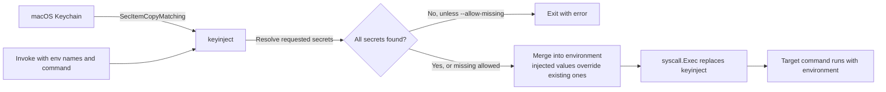

# keyinject

`keyinject` reads generic-password secrets from the macOS Keychain, places them in a target command's environment, then replaces itself with that command. The target receives ordinary environment variables and does not need to know about Keychain.

## How it works



Secrets are provisioned in Keychain separately; `keyinject` only reads them when invoked. `exec` replaces the injector process rather than leaving a wrapper running.

## Requirements

- macOS
- Go 1.22 or newer with cgo enabled
- Xcode Command Line Tools (for the macOS Security and CoreFoundation frameworks)

`keyinject` uses `SecItemCopyMatching` directly. It does not invoke the `security` command to read secrets.

## Build and test

```sh
make build
make test
make vet
```

The binary is written to `bin/keyinject`. To build with a release version string:

```sh
make build VERSION=1.0.0
```

## Provision a secret

Add each secret to the login Keychain. `-w` without a value prompts securely rather than putting the secret in shell history:

```sh
security add-generic-password \
  -s "keyinject.OPENAI_API_KEY" \
  -a "$USER" \
  -w
```

The service name is `keyinject.` followed by the environment variable name by default. Remove any corresponding `export` from shell startup files after migrating it.

## Use

```sh
bin/keyinject --env OPENAI_API_KEY -- python3 app.py
```

The `--` separator is optional but recommended. Everything after it is passed to the target command. Multiple secrets can be requested in one invocation:

```sh
bin/keyinject \
  --env OPENAI_API_KEY \
  --env GITHUB_TOKEN \
  -- git push origin main
```

Options:

| Option | Description |
| --- | --- |
| `--env NAME` | Required; repeatable environment variable name to load from Keychain. |
| `--service-prefix PREFIX` | Keychain service prefix. Default: `keyinject.` |
| `--account NAME` | Keychain account. Default: current user. |
| `--allow-missing` | Continue without secrets that are absent from Keychain. |
| `--dry-run` | Resolve requested items and print names and target argv, never secret values; does not run the target. |
| `--verbose` | Log resolved names and execution target to stderr, never values. |
| `--version` | Print the build version. |

A dry run reports absent items as `MISSING` and exits successfully. Without `--dry-run` or `--allow-missing`, a missing item is an error. `--allow-missing` leaves an absent variable unchanged if it was already present in the invoking environment.

## Code signing

The first Keychain access may prompt for permission. For a persistent **Always Allow** authorization across rebuilds, sign each build with the same code-signing identity and identifier. See [SPEC.md](SPEC.md#7-code-signing-critical) for creating the self-signed development certificate and deployment guidance.

Once the certificate is available in the login Keychain, sign and verify with:

```sh
make sign SIGNING_IDENTITY=keyinject-dev
make verify-signature
```

Keep `dev.local.keyinject` as the signing identifier. Install the signed binary somewhere not writable by untrusted processes; the spec describes a root-owned `/usr/local/bin` installation.

## Security notes

Secrets are never printed by `keyinject`; they are present in its memory while resolving and are passed to the target through its environment. Processes running as the same user may be able to inspect the target's environment while it runs. The tool does not protect against a process that can replace the `keyinject` executable, or one that runs as the same user after injection. Protect the binary's location accordingly.

`keyinject` only reads secrets; provisioning, rotation, and removal are managed with Keychain Access or the macOS `security` command. See [SPEC.md](SPEC.md) for the complete design and threat model.

## License

See [LICENSE](LICENSE).
