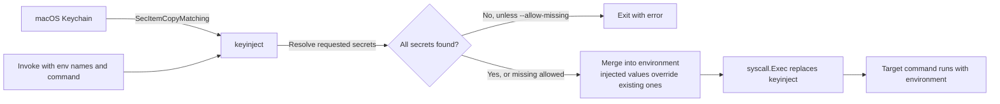

# keyinject

`keyinject` reads generic-password secrets from the macOS Keychain, places them in a target command's environment, then replaces itself with that command. The target receives ordinary environment variables and does not need to know about Keychain.

## Purpose

A small Go CLI that reads secrets from the macOS Keychain and injects them as environment variables into a target command, then `exec`s into that command. Python scripts (and any other scripts) read them via `os.environ` and remain completely unaware of the mechanism.

**Threat model addressed:** secrets currently `export`ed in `.zshrc` are readable by every process under the user account, at all times. After migration, they exist only in Keychain and only for the lifetime of the target process.

**Explicitly out of scope:** a malicious process that can replace the `keyinject` binary, or that runs as the same user *after* injection has occurred (it can read the child's environment via process inspection). Silent access necessarily widens the trust boundary; the spec accepts "any process that can execute `keyinject` can obtain the secret."

## Non-goals

- Cross-platform support (Linux/Windows). macOS only.
- Secret write/edit UI. Use `security add-generic-password` or Keychain Access.app for provisioning.
- Touch ID / biometric gating. That is Secretive's domain; here we want *silent* access.
- Rotation, versioning, audit logging (v1).

## How it works



Secrets are provisioned in Keychain separately; `keyinject` only reads them when invoked. `exec` replaces the injector process rather than leaving a wrapper running.

## Requirements

- macOS
- Go 1.22 or newer with cgo enabled
- Xcode Command Line Tools (for the macOS Security and CoreFoundation frameworks)

`keyinject` uses `SecItemCopyMatching` directly via cgo. It does not shell out to `/usr/bin/security` to read secrets, because doing so would attribute the Keychain ACL check to `security` and make the secret readable by any process running `security find-generic-password`.

The Keychain query uses a generic-password dictionary:

```
kSecClass            = kSecClassGenericPassword
kSecAttrService      = "<service-prefix><NAME>"
kSecAttrAccount      = "<account>"        // default: current user
kSecReturnData       = true
kSecMatchLimit       = kSecMatchLimitOne
```

The result is read as raw bytes and converted to a UTF-8 string. Trailing newlines from `security add-generic-password` inputs are stripped (one trailing `\n` only).

## Build and test

```sh
make build
make test
make vet
```

The binary is written to `bin/keyinject`. To build with a release version string:

```sh
make build VERSION=1.0.0
```

## Provision a secret

Add each secret to the login Keychain. `-w` without a value prompts securely rather than putting the secret in shell history:

```sh
security add-generic-password \
  -s "keyinject.OPENAI_API_KEY" \
  -a "$USER" \
  -w
```

The service name is `keyinject.` followed by the environment variable name by default. Remove any corresponding `export` from shell startup files after migrating it.

## Use

```sh
bin/keyinject --env OPENAI_API_KEY -- python3 app.py
```

The `--` separator is optional but recommended. Everything after it is passed to the target command. Multiple secrets can be requested in one invocation:

```sh
bin/keyinject \
  --env OPENAI_API_KEY \
  --env GITHUB_TOKEN \
  -- git push origin main
```

Options:

| Option | Description |
| --- | --- |
| `--env NAME` | Required; repeatable environment variable name to load from Keychain. |
| `--service-prefix PREFIX` | Keychain service prefix. Default: `keyinject.` |
| `--account NAME` | Keychain account. Default: current user. |
| `--allow-missing` | Continue without secrets that are absent from Keychain. |
| `--dry-run` | Resolve requested items and print names and target argv, never secret values; does not run the target. |
| `--verbose` | Log resolved names and execution target to stderr, never values. |
| `--version` | Print the build version. |

A dry run reports absent items as `MISSING` and exits successfully. Without `--dry-run` or `--allow-missing`, a missing item is an error. `--allow-missing` leaves an absent variable unchanged if it was already present in the invoking environment.

## Execution model

`keyinject` builds `os.Environ()` plus one `NAME=value` entry per resolved secret, with injected values overriding any preexisting entry of the same name.

The target executable is resolved via `exec.LookPath` when `argv[0]` contains no slash; otherwise it is used verbatim.

`keyinject` then calls `syscall.Exec(path, argv, env)`, which replaces the `keyinject` process with the target:

- The target's exit code is the exit code observed by the shell — no wrapper indirection.
- The target owns stdin/stdout/stderr and all signal handling.
- `keyinject`'s memory is reclaimed by the kernel when the exec transitions; there is no lingering parent process holding secrets.

If `syscall.Exec` fails, the error is printed to stderr and `keyinject` exits `1`.

Do not use `exec.Command(...).Run()`: that spawns a child and leaves `keyinject` alive, waiting, with secrets still in its memory and the child in its process tree. `syscall.Exec` is the only correct primitive here.

## Exit codes

- `0` — target command exited 0 (or `--dry-run`/`--version` succeeded).
- `1` — resolution error (missing key without `--allow-missing`, Keychain read error) or exec failure.
- `2` — usage error (no `--env`, no command).
- Otherwise, the target process's own exit code.

## Code signing

The first Keychain access may prompt for permission ("keyinject wants to access…"). Click **Always Allow**. For a persistent **Always Allow** authorization across rebuilds, sign each build with the same code-signing identity and identifier. Without this, every `go build` produces a new cdhash and Keychain's "Always Allow" record is invalidated on each rebuild, so the dialog returns.

### Create a self-signed signing certificate (one-time)

1. Keychain Access → Certificate Assistant → Create a Certificate.
2. Name: `keyinject-dev`, Identity Type: Self Signed Root, Certificate Type: **Code Signing**.
3. Create it in the **login** keychain.

### Sign the binary

```sh
make sign SIGNING_IDENTITY=keyinject-dev
make verify-signature
```

This runs:

```sh
codesign --force --sign "$SIGNING_IDENTITY" --identifier dev.local.keyinject bin/keyinject
codesign --verify --strict --verbose=2 bin/keyinject
```

Keep `dev.local.keyinject` as the signing identifier. If you rebuild with `--identifier` and certificate unchanged, Keychain will continue to recognize the new binary as the authorized one, and no dialog will appear.

Install the signed binary somewhere not writable by untrusted processes, e.g.:

```sh
sudo install -m 0755 -o root -g wheel bin/keyinject /usr/local/bin/keyinject
```

Putting it in `~/bin` is acceptable for local use but widens the tamper window: any process that can write to `~/bin` can replace it with a binary that prints secrets. `/usr/local/bin` (root-owned) closes that.

## Example usage

### Migration from `.zshrc`

Before:

```bash
# ~/.zshrc
export OPENAI_API_KEY=sk-...
export ANTHROPIC_API_KEY=sk-ant-...
export GITHUB_TOKEN=ghp_...
```

Move each into Keychain:

```sh
security add-generic-password -s keyinject.OPENAI_API_KEY    -a "$USER" -w
security add-generic-password -s keyinject.ANTHROPIC_API_KEY -a "$USER" -w
security add-generic-password -s keyinject.GITHUB_TOKEN      -a "$USER" -w
```

Remove the three `export` lines from `.zshrc`. `exec zsh`.

### Running a Python script

`hello.py`:

```python
import os
import requests

resp = requests.get(
    "https://api.openai.com/v1/models",
    headers={"Authorization": f"Bearer {os.environ['OPENAI_API_KEY']}"},
    timeout=10,
)
print(resp.status_code)
```

Run it:

```sh
bin/keyinject --env OPENAI_API_KEY -- python3 hello.py
```

First run: macOS asks "keyinject wants to access keyinject.OPENAI_API_KEY" → click **Always Allow**. Subsequent runs are silent.

The script sees `OPENAI_API_KEY` as a normal environment variable. It knows nothing about Keychain, `keyinject`, or the `--` separator.

### Multiple secrets, single invocation

```sh
bin/keyinject \
  --env OPENAI_API_KEY \
  --env ANTHROPIC_API_KEY \
  --env GITHUB_TOKEN \
  -- python3 scripts/sync_docs.py
```

All three are injected into that process's environment; none survive after the process exits.

### Passing arguments to the target

```sh
bin/keyinject --env GITHUB_TOKEN -- git push origin main
```

Everything after `--` is argv for `git`. `keyinject` does not parse it.

### Dry run (verify what will be injected, without exposing values)

```sh
$ bin/keyinject --env OPENAI_API_KEY --env GITHUB_TOKEN --dry-run -- python3 app.py
resolved: OPENAI_API_KEY
resolved: GITHUB_TOKEN
argv: ["python3" "app.py"]
```

Missing keys show up as `MISSING` under `--dry-run`, or fail the run (exit `1`) without `--allow-missing`.

### Tolerating optional secrets

```sh
bin/keyinject --env SENTRY_DSN --env SENTRY_ENV --allow-missing -- ./bin/app
```

If `SENTRY_DSN` is not in Keychain, `keyinject` proceeds with just `SENTRY_ENV`. Any script must handle the absence — this is not a silent default; it's an explicit opt-in.

### A shell wrapper for convenience

```sh
# ~/bin/run-openai
#!/bin/sh
exec /usr/local/bin/keyinject --env OPENAI_API_KEY -- "$@"
```

```sh
chmod +x ~/bin/run-openai
run-openai python3 script_that_calls_openai.py
```

The wrapper is not trusted by Keychain — `keyinject` is. The wrapper is just an alias.

### A Makefile target

```makefile
test:
	@keyinject --env OPENAI_API_KEY -- python3 -m pytest -q
```

The Makefile contains no secret. Checkout, `make test`, done.

## Extension hooks (v2, reserved)

Reserving namespace so v1 doesn't paint itself into a corner:

- `--stdin NAME=...` to inject a secret over stdin (for secrets you don't want passed as an env at all).
- `--audit-log <path>` to append one line per run: timestamp, requesting process's `pid`/`ppid`, injected key names (never values). This makes "who used what" inspectable.
- `--ttl <duration>` is **not** feasible without a resident agent; if you want it, run an agent rather than extending `keyinject`.

## Acceptance criteria

- `keyinject --env FOO -- printenv FOO` prints the secret and exits `0`.
- Same command, second invocation, produces **no** Keychain dialog.
- After a `go build` + `codesign` rebuild, dialog **does not** return.
- `keyinject --env MISSING -- printenv MISSING` exits `1` with a clear message.
- `keyinject --env MISSING --allow-missing -- true` exits `0`.
- `keyinject --dry-run --env FOO -- true` prints `resolved: FOO` and **not** the value.
- `keyinject --env FOO -- sh -c 'exit 42'` exits `42`.
- `keyinject --env FOO -- python3 -c 'import os, time; print(os.environ["FOO"]); time.sleep(5)'` — while it sleeps, `ps eww -p $PID` does **not** reveal the secret on the command line (it will appear in the process environment block, which is expected; the point is it isn't in argv).
- `keyinject` invoked with no `--env` exits `2` with usage.
- `keyinject` invoked with no command exits `2` with usage.

## Security notes

Secrets are never printed by `keyinject`; they are present in its memory while resolving and are passed to the target through its environment. Processes running as the same user may be able to inspect the target's environment while it runs. The tool does not protect against a process that can replace the `keyinject` executable, or one that runs as the same user after injection. Protect the binary's location accordingly.

`keyinject` only reads secrets; provisioning, rotation, and removal are managed with Keychain Access or the macOS `security` command.

## License

See [LICENSE](LICENSE).
